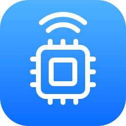

<div align="center">



# ASRock A620AI WiFi — Drivers

**Перевстановив Windows і нічого не працює? Усі драйвери — на одній сторінці.**<br>
Простий сайт, який по порядку веде від чипсета до звуку:<br>
чипсет, LAN, Wi-Fi, Bluetooth і аудіо для Windows 11 64-bit.

[](https://dimonchikk.github.io/ASRock-A620AI-WiFi/)
[](#-драйвери)
[](#-драйвери)
[](#-драйвери)
[](https://dimonchikk.github.io/ASRock-A620AI-WiFi/)

### [🌐 Відкрити сайт](https://dimonchikk.github.io/ASRock-A620AI-WiFi/) · [Драйвери](#-драйвери) · [Порядок](#-порядок-встановлення) · [Можливості](#-можливості-сайту) · [Питання](#-питання)

</div>

---

## 📦 Драйвери

| Тип | Драйвер | Розмір | Завантажити |
|---|---|---|---|
| Chipset | AMD Chipset Driver | 71.2 MB | [MEGA](https://mega.nz/file/nQ0UiK6b#F0radTbgUirP84tqSZ49DeuCYlnFKCJmfbEJnc_dOPw) |
| LAN | Realtek LAN Driver | 4.92 MB | [MEGA](https://mega.nz/file/DRs0CDJY#DdNoCpK9NEkdbkn7fFIL3kNyca3-J_b1wJQ3sLYu-IA) |
| Wi-Fi | MediaTek Wireless LAN Driver | 25.4 MB | [MEGA](https://mega.nz/file/rVEXSJyB#bzszbmg-nwSLkUHaO55cxTFnDktHadHKOMN18B6rQvE) |
| Bluetooth | MediaTek Bluetooth Driver | 5.22 MB | [MEGA](https://mega.nz/file/LcEA3YrQ#Wmy6sgiYZFd0qfjva75Cj17c9qubcCmY2Ojkwo9lCoY) |
| Audio | Realtek High Definition Audio Driver | 55.4 MB | [MEGA](https://mega.nz/file/LJl0ECTT#BoVzkYgGsCw6VO89CnMtaRh3nzqdgiHuwt6_SgCHIfA) |

## 🔢 Порядок встановлення

1. **Чипсет** — першим, потім перезавантаження
2. **LAN і Wi-Fi** — щоб з'явився інтернет
3. **Bluetooth** — після Wi-Fi (один модуль MediaTek)
4. **Звук** — і фінальне перезавантаження

## ✨ Можливості сайту

- Картки драйверів з іконками, розміром і коротким описом
- Пошук і фільтри: Система / Мережа / Звук
- Уже завантажені драйвери позначаються зеленим (запам'ятовується в браузері)
- Три мови — українська, російська, англійська
- Світла й темна тема (за замовчуванням — як у системі)
- Нормально виглядає на телефоні

## ❓ Питання

<details><summary>Як встановити драйвер?</summary>

Розпакуй архів і запусти `Setup.exe` / `Install.exe`. Якщо інсталятора немає — Диспетчер пристроїв → «Оновити драйвер» → «Знайти на цьому комп'ютері» → розпакована папка.
</details>

<details><summary>MEGA пише про ліміт трафіку</summary>

Зачекай трохи або відкрий посилання через застосунок MEGA чи інший браузер.
</details>

## 🛠 Структура

```
index.html       — увесь сайт (HTML + CSS + JS, без залежностей)
assets/icon.svg  — іконка
```

Сайт публікується через GitHub Pages з гілки `main`. Щоб додати драйвер — допиши об'єкт у масив `DRIVERS` в `index.html`.

---

<sub>Неофіційний проєкт. ASRock — торговельна марка ASRock Inc.; репозиторій з нею не пов'язаний. Офіційні драйвери: [asrock.com/support](https://www.asrock.com/support/index.asp).</sub>
